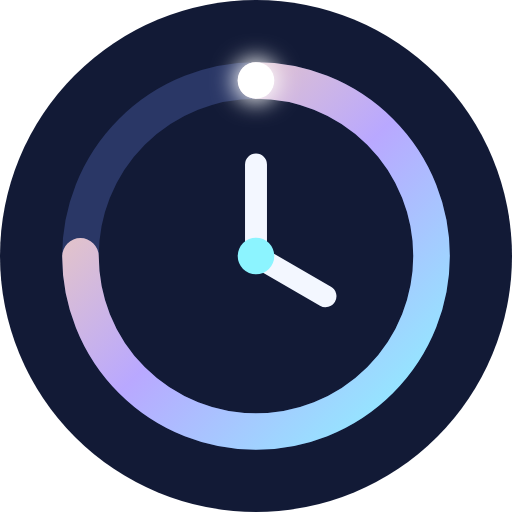
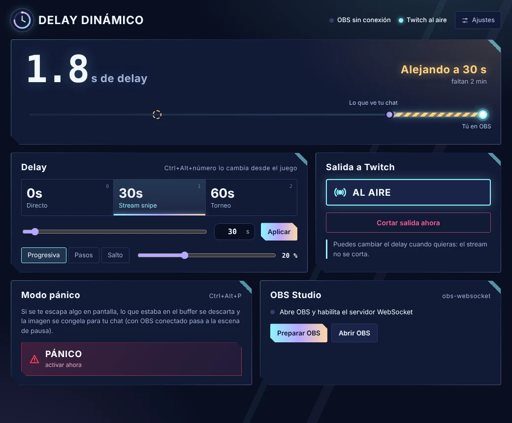

  

<h1 align="center">Delay Dinámico</h1>

  Cambia el delay de tu stream de Twitch <b>en vivo, sin cortar la transmisión</b>. 
  Integración con OBS, presets anti stream snipe y botón de pánico. Gratis para Windows.

  <a href="https://github.com/Benjah42/Delay-Dinamico/releases/latest/download/DelayDinamico.zip"><b>⬇ Descargar</b></a>
  &nbsp;·&nbsp;
  <a href="https://benjah42.github.io/Delay-Dinamico/">Página web</a>

  

## Qué hace

Delay Dinámico se pone entre OBS y Twitch. Sube el delay cuando entras a partida para que no te hagan stream snipe y bájalo en el lobby para hablar con tu chat en directo.

- **Delay en vivo, sin cortes:** presets de 0 s (Directo), 30 s (Stream snipe) y 60 s (Torneo), o los segundos exactos que quieras, hasta 10 minutos.
- **Transición progresiva:** el stream se reproduce un poco más lento o más rápido hasta llegar al nuevo delay, sin congelarse ni saltar.
- **Botón de pánico (`Ctrl+Alt+P`):** lo que tu chat aún no vio se descarta y OBS pasa a una escena de pausa.
- **OBS en un clic:** se conecta por WebSocket y configura OBS automáticamente.
- **Atajos dentro del juego:** `Ctrl+Alt+0`, `1` y `2` cambian el delay sin salir de la partida.
- **Liviana:** no re-codifica tu video y vive junto al reloj de Windows.

## Cómo instalar

1. [Descarga el zip](https://github.com/Benjah42/Delay-Dinamico/releases/latest/download/DelayDinamico.zip) y descomprímelo en una carpeta fija.
2. Doble clic en **Abrir Delay Dinamico.bat**. La primera vez descarga FFmpeg sola.
3. En **Ajustes**, pega tu clave de transmisión de Twitch y la contraseña del WebSocket de OBS.
4. Pulsa **Preparar OBS** y luego **Iniciar**.

**Requisitos:** Windows 10 u 11 de 64 bits · OBS Studio 28 o superior · codificador H.264.

> Si Windows muestra "Windows protegió su PC", haz clic en **Más información** → **Ejecutar de todas formas**. Aparece porque la app no está firmada.

## Apoyar el proyecto

Delay Dinámico es gratis para uso personal. Si te sirve, puedes apoyar el proyecto ❤

---

No está afiliado con Twitch, Riot Games ni OBS Project.
